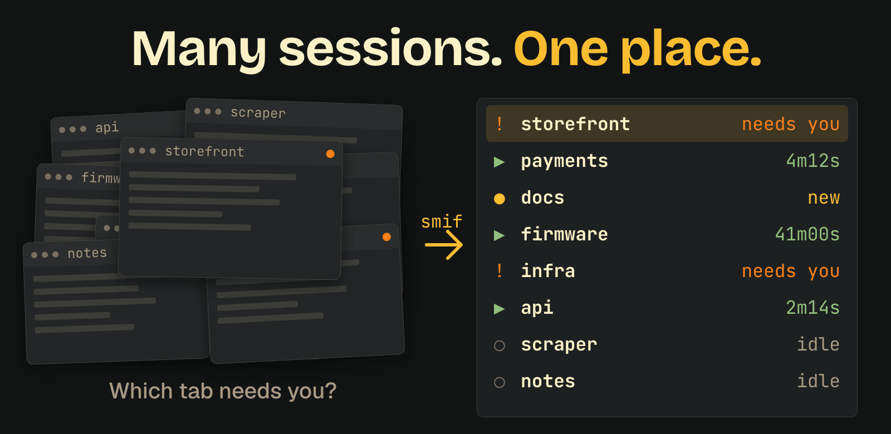
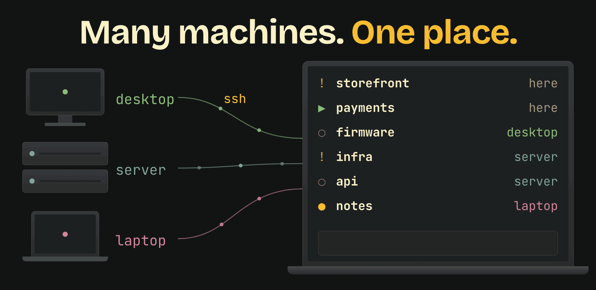
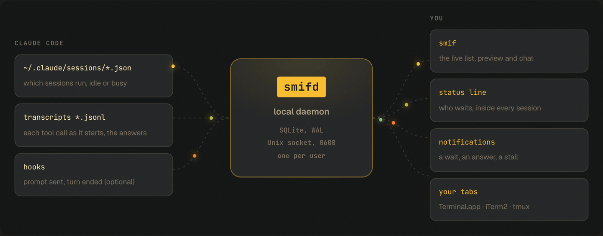

<p align="center">
  <a href="https://smif.dev">
    <picture>
      <source media="(prefers-color-scheme: dark)" srcset="docs/brand/logo-dark.svg">
      
    </picture>
  </a>
</p>

<p align="center">
  <b>Many sessions. Many machines. One place.</b><br>
  See which Claude Code or Codex session waits for you, on any machine, and answer it without hunting for the tab.<br>
  Keep your terminal. Nothing to migrate, and your sessions run with or without smif.
</p>

<p align="center">
  <a href="https://smif.dev"><b>smif.dev</b></a> ·
  <a href="#install">Install</a> ·
  <a href="#docs">Docs</a>
</p>

<p align="center">
  <a href="https://github.com/appnice/smif/releases/latest"></a>
  <a href="#install"></a>
  <a href="LICENSE"></a>
</p>

<p align="center">
  
</p>

<p align="center">
  
</p>

## Features

- **[See every session](#see-every-session):** one live list shows what each session runs now and which one needs you.
- **[Answer from one place](#answer-from-one-place):** pick a row and type. A busy session queues your line.
- **[Other machines](#other-machines):** add a machine over ssh, and its sessions join the same list.
- **[Stop watching the screen](#stop-watching-the-screen):** get a notification when a session starts to wait or answers after a long turn.
- **[Send messages between projects](#send-messages-between-projects):** sessions ask each other things without interrupting yours.
- **[Other agents](#other-agents):** Claude Code and Codex are checked against real agents, and others show up too.
- **[Coming from Conductor?](#coming-from-conductor):** keep your terminal, with nothing to migrate.

## Install

```sh
curl -fsSL https://smif.dev/install.sh | sh
smif
```

smif finds your open sessions on its own, with no config. It needs Claude Code 2.1 and git, on macOS or Linux.

<details>
<summary>Other ways to install</summary>
<br>

The script puts `smif` in `~/.local/bin` and checks its checksum ([read it](site/install.sh)). Set
`SMIF_INSTALL_DIR` for another folder.

```sh
go install github.com/appnice/smif/cmd/smif@latest   # Go 1.27.2 or newer
```

Binaries are on the [release page](https://github.com/appnice/smif/releases/latest). They are not notarized, so on
macOS a file saved from a browser needs `xattr -d com.apple.quarantine smif`.

</details>

## See every session

<p align="center">
  
</p>

| Row | Meaning |
|---|---|
| `! 3m … needs you` | Stopped on a permission prompt or a question |
| `▶ 4m12s … Bash npm run build` | Working, and the step it runs now |
| `● new` | An answer you have not read |
| `○` | Idle |

`tab` jumps to the next session that needs you. `o` brings its tab to the front.

smif never answers a permission prompt for you.

## Answer from one place

<p align="center">
  
</p>

`enter` opens a chat with the selected session.

- **Idle:** smif types your prompt into its tab. This works in Terminal.app, iTerm2, tmux and herdr.
- **Busy or waiting:** the text waits in a queue and goes in when the session is idle. `ctrl+f` asks a read-only fork instead, which needs `smif init`.

A long paste stays whole, `ctrl+v` attaches an image, and smif warns you before it sends something that looks like a
secret.

| Key | Does |
|---|---|
| `tab` | Next session that needs you |
| `enter` | Chat |
| `o` | Go to the session's tab |
| `p` | Send a saved prompt |
| `n` | New session in the same folder |
| `m` | Machines |
| `y` | Copy the newest code block |
| `Y` | Copy the newest answer |
| mouse drag | Select inside one pane and copy |
| `?` | All keys |

## Other machines

Press `m` in smif, or run `smif remote add`. Pick a machine from your network, `~/.ssh/config` or Tailscale, or type an
address, and smif sets it up. You type the password once.

You can read its sessions here, and a session that starts to wait notifies you. Writing is off until you turn it on for
that machine with `w`. Then you can type into its sessions and start new ones with `n`. smif uses its own key, which
cannot open a shell, and there is no server in the middle. See [docs/usage.md](docs/usage.md).

## Stop watching the screen

smif sends a notification when a session starts to wait, or answers after a long turn.

With `smif install`, the status line of each session names the others:

```
! shop waits · ● docs, scraper answered
```

`smif install` also adds hooks, `/smif`, the MCP server and a background service. It backs up every file it changes.

## Send messages between projects

Sessions can ask each other things, like mail between projects:

```
ask the web agent if v2.3 is live
```

The message waits on disk. Your rules decide what handles it, and your open sessions are not interrupted.

| Message | Handled by | You get |
|---|---|---|
| A question with a known answer | A script, no model | An answer in about 25 ms |
| A crash or a code question | A background `claude -p` with locked tools | A summary, and a fix as a branch to merge |
| A note, like a finished build | The digest | One line in `/smif` |
| A decision for you | You | A notification |

Set it up with `smif install` and `smif init`. See [docs/messages.md](docs/messages.md).

## Other agents

Claude Code, Codex and OpenCode are checked against a real agent. The rest come from reading their source, so expect faults.

A new Codex or OpenCode session takes prompts from smif after its first message.

| Agent | Support |
|---|---|
| Claude Code | Everything |
| Codex | See, type when idle, queue. Cannot see an approval prompt, so no `needs you` |
| OpenCode | See, type when idle, queue. An approval reads as busy, so no `needs you` |
| Qwen Code, GitHub Copilot CLI, Factory Droid | Read only, not verified |
| 21 more, in a [herdr](https://herdr.dev) pane | Name, folder and state, not verified |
| Any other agent, with `[harnesses.<name>]` in the config | Name and folder, see [docs/agents.md](docs/agents.md#add-an-agent) |

Mail also works between Claude Code and Codex, so one can ask the other to review a diff
([docs/messages.md](docs/messages.md#codex)). Forks work with Claude Code only. See [docs/agents.md](docs/agents.md).

## Coming from Conductor?

Conductor's cloud ends on November 20 and its Mac app winds down in 2027. smif is a different kind of tool: it does not create workspaces, it gives you one list of the sessions you already run.

| | Conductor | smif |
|---|---|---|
| Sessions | Created inside the app | The ones you already have open |
| Where you work | In the app | In your own terminal |
| Workspaces | A git worktree per task | Any folder or worktree you use |
| Review and merge | In the app | Your own git tools |
| Agents | Claude Code, Codex, Cursor | Claude Code, Codex, more coming soon |
| Systems | macOS | macOS, Linux |
| Other machines | Its cloud, ending November 20 | Yours, over ssh |
| Code | No public repo | Open, MIT |
| Future | Mac app winds down in 2027 | MIT, and your sessions run without it |

As of November 2026.

## How it works

<p align="center">
  
</p>

smif reads the files Claude Code already writes, and one local daemon keeps the state. Nothing leaves your machine:
no server, no cloud, no telemetry. The exceptions are the machines you add and a phone ping that you turn on with `daemon.notify_url`: it
sends the agent or folder name and what happened, with no prompt or answer ([docs/safety.md](docs/safety.md)).

## Uninstall

```sh
smif uninstall
```

This puts back every file byte for byte. Your data stays in `~/Library/Application Support/smif` or
`~/.local/share/smif` until you delete it.

## Docs

- [Usage](docs/usage.md): every key, notifications, saved prompts, stats
- [Messages](docs/messages.md): rules, workers, configuration
- [Agents](docs/agents.md): support levels per agent
- [Safety](docs/safety.md): what workers can do, and common questions
- [Numbers](docs/numbers.md): latency, tokens, failure tests
- [Spec](docs/rfc.md), [decisions](docs/adr), [compatibility](docs/compat.md)

To work on smif, run `make check`, or `make check-linux` for Docker.

## License

MIT
