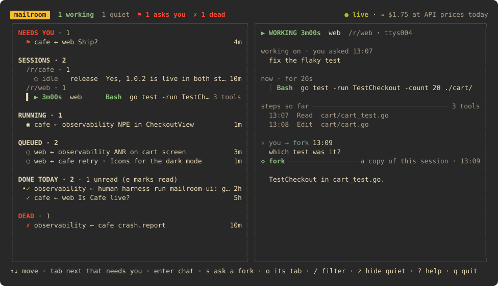

<div align="center">

# Smif

**One terminal view of all your Claude Code sessions.<br>See which one needs you and what each one does now. Write to any of them.**

[](go.mod)
[](#install)
[](LICENSE)

</div>

Run `smif`. It finds every open Claude Code session on the machine, in any folder, with no setup, and
shows what each one does right now:

```
 smif   1 waiting  2 new  2 working  3 quiet                         ● live
SESSIONS · 8
  ~/work · 7
    ○ idle   api      Done: the migration ran and the tests pass.          2h
    ▶ 4m12s  web      Bash  npm run build                       14 tools
    ! 3m     shop     Bash  git push origin main                needs you
    ● new    docs     The new page is up at /guides/install.               1m
    ▶ 18m    worker   Bash  make e2e                      9 tools · silent 6m
  ~/side · 1
    ● new    scraper  Found 412 listings; 3 pages failed (timeouts).       5m
```

| You see | It means |
|---|---|
| `! 3m … needs you` | The session stopped on a permission prompt or a question in its tab: the row says what it asks for. `o` brings the tab to the front. |
| `▶ 4m12s … Bash npm run build` | It works on your prompt; the row shows the step that runs now. `silent 6m`: it has written nothing for 6 minutes (a long command, or stuck). |
| `● new` | An answer you have not read. The preview shows your prompt and only the final answer, no steps or tool output. |
| `tab` | Goes to the next session that needs you. |

You do not have to watch the screen:

- **Notifications.** An OS notification comes when a session starts to wait in its tab, or answers after a turn
  of more than 30 s. Set `daemon.session_notify` to `"waiting"`, `"answered"` or `"none"`.
- **Status line.** With `smif install`, the status line of each session names the others:
  `! shop waits · ● docs, scraper answered`.
- **Watchdogs.** A reminder while a session still waits (`daemon.remind_waiting`, default every 10 min, at most
  3 times), and one alert when a working session writes nothing for `daemon.alert_silent` (default 10 min) or works
  longer than `daemon.alert_long_turn` (off by default).

Write to a session from the same screen. `enter` opens a chat with it:

| The session is | Your text |
|---|---|
| **idle** | Is typed into its tab and sent, as if you typed it there (Terminal.app, iTerm2 or tmux). |
| **busy** or **waiting** | Is not typed. A fork of the session answers (`claude -p --resume … --fork-session`): it knows what the session knows, works read-only, and leaves the session untouched. Needs an agent for the folder (`smif init`). |

Smif never answers a permission prompt for you.

Prompts you send often go in the config, and `p` on a session sends one (`@tests` in any prompt stands for it):

```toml
[prompts]
tests = "run the tests and report what failed"
review = "review your last change for bugs, then list them"
```

`n` opens a new session: `claude --name <name>` in the selected session's folder, in a new Terminal.app window,
iTerm2 tab or tmux window.

### Optional: messages between sessions

With `smif init`, sessions and scripts can also send messages to a project. Smif sorts them with your rules, and no message
text enters a session that you type in:

<div align="center">

</div>

| Message | Handler | Result |
|---|---|---|
| An ask with a known answer | **command**: a script, no model | The asking session gets the answer in about 25 ms. |
| A crash, an error, a code question | **worker**: a headless `claude -p` with a locked tool set | You get a summary in `/smif`. A fix is a branch for you to merge. |
| An ask to a session's name | **fork** of that session | The asker gets an answer from the session's context. Nothing is typed into it. |
| Information (a build is done) | **digest** | You get one line in `/smif`. |
| A decision for a human | **escalate** | You get a count in the status line, an OS notification and an item in the UI. |

## Numbers

All numbers come from `make bench` on one laptop with a fake model. The benchmark costs $0. Each scenario
ran one time. The full report is in [bench/results](bench/results/2026-11-02-3711a61/report.md), and the method
is in [docs/rfc-benchmark.md](docs/rfc-benchmark.md).

| Latency | p50 | p99 |
|---|---|---|
| Ask answered by a command, 20 per second | 25 ms | 30 ms |
| Message stored and routed, 200 per second | 10 ms | 23 ms |
| Hook in your session, at that load | 10 ms | 21 ms |
| Status line, at that load | 10 ms | 15 ms |
| Smif time around one worker run | 28 ms | |

| Tokens | |
|---|---|
| Command handler | 0 |
| Smif text in one worker run | about 570 |
| Smif tool definitions in your session (one time) | about 500 |
| Same question, Smif worker vs. plain `claude -p` in the same repo | **15 450 vs. 63 922** context tokens |

| Failure test | Result |
|---|---|
| `kill -9` on the daemon with 92 messages in flight | 0 lost. All done 13 s after the restart. |
| 500 copies of one crash event | 2 worker runs |
| Two workers that always ask each other | Stopped after 4 runs |
| A marker string in 20 inbound messages | Found 0 times in your session |

## Install

You need Claude Code 2.1 (checked with 2.1.316) and git, on macOS or Linux.

**A release binary** (darwin and linux, amd64 and arm64), from [Releases](https://github.com/appnice/smif/releases):

```sh
curl -L https://github.com/appnice/smif/releases/latest/download/smif_$(uname -s | tr A-Z a-z)_$(uname -m | sed -e s/x86_64/amd64/ -e s/aarch64/arm64/).tar.gz | tar -xz smif
mkdir -p ~/.local/bin && mv smif ~/.local/bin/
```

**Or with Go** (1.27.2 or newer): `go install github.com/appnice/smif/cmd/smif@latest`

**Or from source:** `git clone https://github.com/appnice/smif && cd smif && make build && make install-local`

Then:

```sh
smif          # the session view, with no setup: it starts the daemon in the background
smif install  # optional: the status line, hooks, /smif, the MCP server, and the daemon as a service
smif init     # optional, for messages and forks: finds your git repos and gives each one an agent id
smif doctor   # checks the setup
```

Without `smif install`, the daemon that `smif` starts runs until a reboot.

`smif install` makes a backup of each file that it changes. `smif uninstall` puts back each file
byte for byte.

## Use

| From | How |
|---|---|
| A Claude Code session | Say "ask the web agent if v2.3 is live". The MCP tools are `smif_ask`, `smif_send`, `smif_await`, `smif_agents` and `smif_status`. |
| A shell or a script | `smif ask --to shop --intent store.status --subject "Live?" --wait 30` |
| A crash monitor, CI, cron | `smif emit --as monitor --to shop --intent crash.report --subject "NPE" --dedupe-key npe-1 --body - < report.md` |
| The terminal UI | `smif` |
| All sessions | `smif` (the UI), or `smif sessions` in a shell |
| An idle session | `smif prompt api "run the tests"` types the prompt into the session with that name, as if you typed it there (Terminal.app, iTerm2 or tmux) |
| Your results | `/smif` in a session, or `smif stats` |

<details>
<summary><b>The terminal UI</b></summary>
<br>



- The list shows the items that need you first, then your sessions, running workers, the queue, the items done
  today and dead letters (each group only when it has rows). The right pane shows the selected item. For a running worker, it shows the live tool calls.
- `a` answers, `c` cancels, `t` retries, `e` marks as read. `enter` opens the thread or the run: record,
  transcript and branch diff. On a run, `a` merges the branch after a y/N question.
- The SESSIONS group shows every open Claude Code session, grouped by root folder, in a fixed order, with its
  state (`!` waiting, `▶` working, `●` new answer, `○` idle) and what it does now or the first line of its last
  answer. Sessions need no config: an agent is needed only for messages, workers and forks.
- `tab` goes to the next row that needs you. `z` hides the quiet sessions. Empty groups take no room.
- `p` sends a saved prompt to the session. `n` opens a new session in its folder.
- `enter` on a session opens the chat. `s` writes from the preview. Idle: typed in. Busy: a fork of the session
  answers in the chat. `o` (in the chat `ctrl+o`) brings its tab to the front.
- `:` opens a command prompt with tab completion: `ask`, `tell`, `prompt`, `answer`, `retry`, `agent`, `filter`, `digest`.
- `[` and `]` change the agent. `/` filters. `v` opens the dashboard (agents, runs, audit log). `?` shows all keys.
- In a pipe, `smif` prints one summary. `smif watch` gives a live view for tmux or ssh.

</details>

<details>
<summary><b>Stats: how much work Smif does without you</b></summary>
<br>

`smif stats` shows the last 14 days. Each message has exactly one outcome.

```
  inbound       11 messages (+4 repeats merged), 2 replies
  without you   4 (50% of the work)  command 1 · digest 1 · worker 2
  needed you    3  answered 1 · waiting 2 · cancelled 0
  runs          7 worker, 1 command (1 failed)
  tokens        5.2k in (incl. cache) · 250 out
```

Use `--since 2026-01-01` to set the start date. Use `--json` for scripts.

</details>

<details>
<summary><b>Configuration</b></summary>
<br>

The file is `~/.config/smif/config.toml`. Each agent has its own rules. The first rule that matches
the message is used.

```toml
[agents.shop]
repo = "~/dev/shop"
accept_from = ["monitor", "web"]

[[agents.shop.rules]]                # a script answers, no model
match = { kind = "ask", intent = "store.status" }
handler = "command"
command = ["~/.config/smif/handlers/status.sh"]

[[agents.shop.rules]]                # a read-only worker examines crashes, one run for each problem a week
match = { kind = "event", intent = "crash.*" }
handler = "worker"
profile = "triage"
cooldown = "7d"

[[agents.shop.rules]]
match = { kind = "event", intent = "notice.*" }
handler = "digest"

[[agents.shop.rules]]                # all other messages wait for you
match = {}
handler = "escalate"
```

- **Agent of a session:** the repo of the session folder. For a different folder, start the session with
  `SMIF_AGENT=shop claude`.
- **Profiles** set the model, effort, tools, write scope (`none`, `worktree` or `direct`), turns and timeout.
  The built-in profiles are `triage`, `fix`, `answer` and `release`.
- **Command handlers** get the message as JSON on stdin. They run in the agent repo. They print
  `{"status":"done","summary":"…","reply":"…"}`. `smif init` installs one that answers `status.get` from git.
- To apply a change: `smif config validate`, then `smif reload`. You do not restart the daemon.

</details>

<details>
<summary><b>Safety</b></summary>
<br>

- **Your session.** No inbound message enters a session that a human drives. The only text that Smif types
  into a session is your own prompt. It types only into an idle session, and only when claude is in the foreground
  of its tab. A busy session, or an ask to a session's name, gets a read-only fork instead; the session is not
  touched. The session view reads Claude Code's session files and transcripts, which are not a documented
  interface: `smif doctor` checks their shape. Hooks print nothing. The status line
  shows counts only, for example `mail: shop 1 running · 1 needs you`.
- **Workers.** Claude Code flags lock each worker, not a prompt. `--tools` gives only the tools of the profile, so
  other tools do not exist. Hooks are off. No MCP server loads. Deny rules block the Smif files. A worker
  that can write gets its own git worktree, and you merge its branch. These flags are tested against the
  real CLI ([docs/compat.md](docs/compat.md)).
- **Loops.** A hop limit, a run limit for each thread, ping-pong detection, dedupe and rate limits stop runaway traffic.
- **Data.** SQLite with `synchronous=FULL`. Each state change writes an audit row in the same transaction.
- **Access.** A Unix socket with mode 0600, a peer uid check and one token for each agent. Agents cannot read
  the mail of other agents or the stats. There is no server, no cloud and no telemetry.

</details>

<details>
<summary><b>FAQ</b></summary>
<br>

**Does it cost money?** Workers use your Claude Code login. Command handlers and the digest use no model.

**Can a worker break my repo?** A read-only profile cannot write. The `fix` profile writes in its own worktree on
a `smif/<agent>/…` branch. You examine the diff and merge it. `smif apply` does not merge into a
dirty tree.

**What if the daemon stops?** All accepted messages are on disk. At restart, the daemon stops orphan workers and
tries their messages again. Hooks and the status line fail open: they print nothing and return immediately.

**How do I remove it?** Run `smif uninstall`. Your settings come back byte for byte. The data stays in
`~/Library/Application Support/smif` (or `~/.local/share/smif`) until you delete it.

</details>

<details>
<summary><b>Development</b></summary>
<br>

- `make check` runs gofmt, vet, staticcheck and the race tests, which include 15 acceptance scenarios on a fake
  `claude`. `make check-linux` runs the same checks in Docker.
- `make bench` runs the benchmark. `make smoke-real` makes one real haiku call.
- Documents: [spec](docs/rfc.md) · [decisions](docs/adr) · [acceptance report](docs/acceptance-report.md).

</details>

## License

MIT
